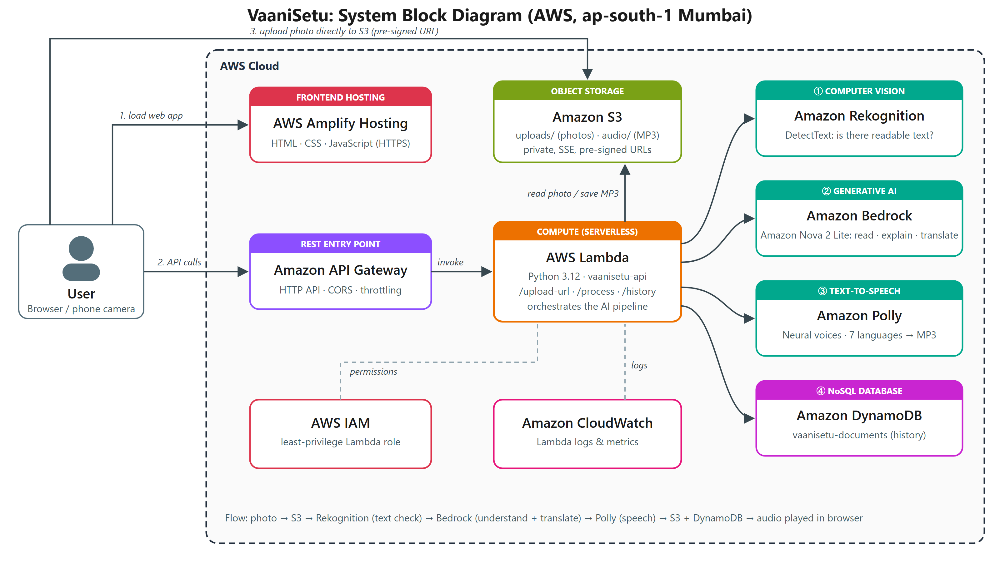

# VaaniSetu

**वाणी सेतु, "a bridge of voice".** Photograph any document (a prescription, bill, notice or form) and hear it explained in your language.

A serverless Google Cloud application built for the Cloud Application Development (CAP 303) mini-project.

- **Live app:** https://storage.googleapis.com/vaanisetu-web-project-2acd026b-3237-497d-89d/index.html
- **Report and slides:** [`deliverables/`](deliverables/)



## How it works

1. The browser gets a signed URL from **API Gateway → Cloud Run function** and uploads the photo straight to a private **Cloud Storage** bucket.
2. **Cloud Vision** checks that the photo contains readable text.
3. **Gemini 3.5 Flash-Lite on Vertex AI** transcribes the document and writes a plain-language explanation, key points and action items in the chosen language.
4. **Cloud Text-to-Speech** speaks the explanation with a neural voice. The MP3 is stored in Cloud Storage.
5. The result is saved to **Firestore** and shown in the history.

The frontend is a static website on **Cloud Storage**. **IAM service accounts** give each component only the roles it needs, and **Cloud Logging** records every request. The function scales to zero, so idle cost is nil; a budget alert guards spending.

Output languages: English, Hindi, Spanish, French, German, Japanese and Arabic.

The project was first built on AWS; that version is tagged [`aws-final`](https://github.com/17mohak/vaanisetu/tree/aws-final).

## Repository layout

| Path | Contents |
|---|---|
| `backend/main.py` | Cloud Run function: `/upload-url`, `/process`, `/history` |
| `frontend/` | Static web app (HTML, CSS, JS) and sample documents |
| `infra/deploy.sh` | Provisions and deploys everything with the gcloud CLI |
| `infra/openapi.template.yaml` | API Gateway configuration |
| `infra/bench_models.sh` | Benchmarks Gemini models on the real prompt |
| `infra/make_samples.py`, `infra/bill.html` | Generate the fictional sample documents |
| `report/` | Block diagram, screenshots, and the report and slide builders |
| `deliverables/` | Final report (DOCX/PDF) and presentation (PPTX/PDF) |

## Deploy

Run in [Google Cloud Shell](https://shell.cloud.google.com), with billing (or the free trial) active:

```bash
git clone https://github.com/17mohak/vaanisetu && cd vaanisetu && bash infra/deploy.sh
```

The script is safe to re-run. It enables the APIs, creates the buckets, Firestore database and service accounts, picks an available Gemini model, deploys the function and API Gateway, uploads the frontend and sets a small budget alert, then prints the site URL. Set `PROJECT=<id>` to target an existing project.

## Rebuild the report and slides

```bash
pip install python-docx
python report/build_report.py "<front-pages.docx>" deliverables/VaaniSetu_MiniProject_Report.docx
npm install --no-save pptxgenjs react-icons react react-dom sharp
node report/build_deck.js deliverables/VaaniSetu_Presentation.pptx
```

The front-page template is the college's `Mini-Project Report Front Pages.doc`, saved as `.docx`.
